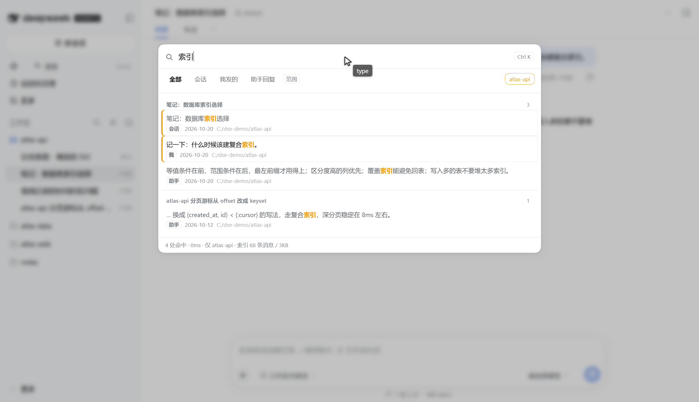
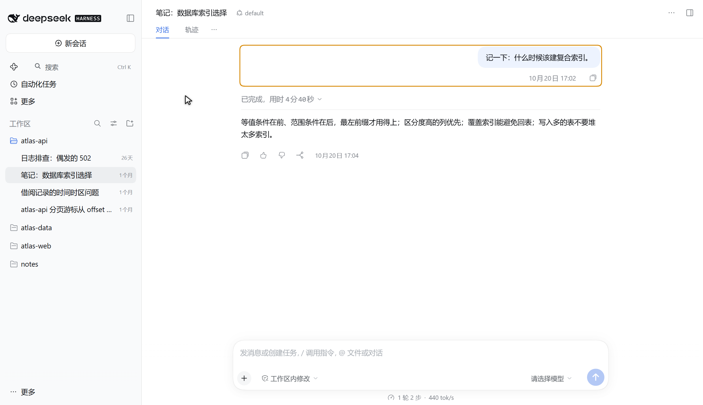
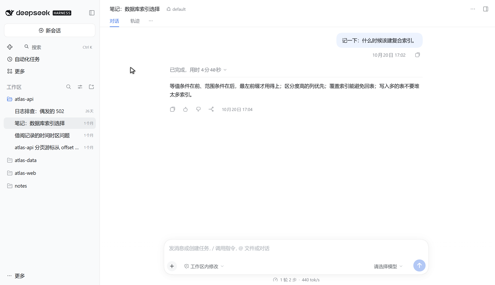

# dsh-search-everything

Everything-style global search for [DSH](https://github.com/deepseek-ai/dsh): press **Ctrl K** and search
across **every session of every workspace** — session titles, your own messages, assistant replies —
then hit Enter to jump straight to that message inside the conversation and highlight it.

- One search box, four tabs: All / Sessions / My messages / Assistant replies
- Optional scope: limit the search to one workspace (the pill on the tab row), down to 4 ms on a 31 MB corpus
- Index lives in the host process and is persisted to disk: a restart restores it in ~0.3 s instead of
  re-parsing every log, and a query over ~30 MB / 18k messages takes 10–90 ms
- Clicking a result switches workspace, switches session, scrolls to the message and flashes it
- Local only: reads `~/.dsh/sessions`, no upload, no network, no telemetry



The scope pill limits the search to one workspace — here the palette is already scoped to `atlas-api`,
and `Ctrl W` opens the row with every workspace and its message count:


Jumping to a hit — the target message is scrolled into view and outlined:



The sidebar entry the plugin adds:



## Install

```bash
# from a local checkout
dsh plugin --profile web add link:/absolute/path/to/dsh-search-everything

# or from npm (after publishing)
dsh plugin --profile web add dsh-search-everything
```

Then **restart `dsh web`** — the client bundle revision only changes when the host reloads.
After the restart:

- a "Search  Ctrl K" entry appears in the sidebar under **New session**;
- press **Ctrl K** (**⌘ K** on macOS) anywhere to open the palette; press it again or Esc to close.

## Usage

| Action | Key |
| --- | --- |
| Open / close palette | `Ctrl K` / `⌘ K` |
| Move selection | `↑` `↓` (or `Ctrl P` / `Ctrl N`) |
| Open selected result | `Enter` |
| Switch tab | `Tab` / `Shift Tab`, or `→` `←` when the input is empty |
| Toggle the workspace scope row | `Ctrl W` |
| Pick a workspace while the scope row is open | `→` `←`, or click |
| Close | `Esc` |

Query syntax:

- space-separated words are **AND** (`jellyfin port` = one message containing both)
- double quotes search a phrase (`"write failed"`)
- case insensitive; CJK is matched as a substring (no word segmentation)

> This plugin **linearly scans** instead of building an inverted index. On real data
> (30 MB / 18k messages) a multi-word AND scan takes 10–90 ms, while an inverted index costs
> 20+ seconds of startup time and doubles resident memory. See "Why not an inverted index".

## Why not an inverted index

The first version built a 3-gram bitmap inverted index (223 sessions / 16k documents /
713k grams / 30M characters). Measured: index build 23.5 s, per-query 0–7 ms. Conclusions:

- linear scanning is already fast: rare words prune almost everything, and the longest term
  is compared first, so far fewer characters are touched than the corpus size suggests;
- the inverted index turned "usable 4 s after start" into "usable 23 s after start", at twice the memory;
- it saved ~6 ms per query — invisible to a human, while the startup cost is very real.

So the simplest path stays: an in-memory document array with a pre-lowercased `lower` field and
`indexOf`-based multi-word AND.

## How it works

```
~/.dsh/sessions/<encoded cwd>/<sessionId>/session.v4.jsonl.zstd
        │  zstd inflate + per-line JSON (only user/message, assistant/message, session/title, session header)
        ▼
Host half (src/engine.ts)  — in-memory index: { sid, title, cwd, role, seq, time, text, lower }
        │  restored from $DSH_HOME/storages/dsh-search-everything when present, full build otherwise;
        │  afterwards rescanned on demand — no background polling
        ▼
GET /dsh-search-everything-api/{refresh,query,sessions,workspaces,doc,stats,flush}   (loopback only)
        ▼
Browser half (client.js)  — Ctrl K palette, list rendering, keyboard handling, jump & highlight
```

**Only human words are indexed.** `user/message` records carry more than twenty different
`source.kind` values; only `user`, `user-approval`, `agent-message`, the empty value, and
`dsh-ops:*` (excluding `step-tail`) count as human input. System echoes such as
`runtime-context`, `tool-jobs`, `repeat-tool-reminder` and `compact-checkpoint` are dropped —
otherwise the "My messages" tab would be full of runtime context.

**Jumping is not just scrolling to the bottom.** The palette asks the host for the hit's original
text plus the match offset, cuts several short excerpts around that offset as search needles
(long excerpts fail to match because markdown markers, inline code and line breaks do not survive
rendering), then:

1. `unarchiveSession` when needed — **archived sessions fail to open silently** in the host;
2. only when the host has no session attached, locate the owning workspace by `sessionIds`/`path`
   and `openWorkspace`;
3. `uiWorkspace.openSession(sid)` to switch the session, waiting for
   `[data-conversation-session]` to report the target session;
4. wait until the message flow has rendered enough `[data-chat-flow-key]` nodes, then scroll the
   virtualized list backwards screen by screen (it anchors to the bottom, so a plain
   `scrollIntoView` gets snapped back), and finally `scrollIntoView({block:'center'})` plus a
   2.6 s highlight.

**Scoping narrows the scan, it does not filter afterwards.** Documents are grouped by their session's
working directory once and cached, and a scoped query reads only that group — on the 31 MB corpus
`search` goes from 32 ms to 4 ms and `Everything` from 22 ms to 2 ms. The palette opens on the workspace
the current conversation belongs to; `Ctrl W` (or the pill) switches to another one or back to all.

**The index survives restarts.** Building it means inflating and parsing every session log — about
4.6 s for 229 sessions / 31 MB, and far worse on a cold page cache. So the documents are written to
`$DSH_HOME/storages/dsh-search-everything/` as `index.meta.json` (one stat entry and the title/cwd
per session file) plus `docs.ndjson` (one JSON tuple per message), and the next start reads them back
in **~340 ms**, then does one incremental pass that re-reads only the files whose mtime or size
changed. Writes are debounced by 1.2 s and atomic (temp file + rename), so a crash leaves the previous
index intact; a version or session-root mismatch discards the cache and rebuilds.

**Refreshing is on demand, not on a timer.** After that the index is never touched until something
asks for it: the palette calls `/refresh` the moment it opens, which stats every session file and
re-reads only those whose mtime/size changed — a few hundred milliseconds when nothing changed, and
the usual case (one session being written) is one file. Between openings the plugin does zero disk
I/O, so an idle host stays idle.

## Configuration

In the `config` block of `cordis.patch.yml`:

```yaml
- insert:
    - id: dsh-search-everything
      name: dsh-search-everything
      config:
        refreshIntervalMs: 0      # background poll interval; 0 = off (default, on-demand)
        lazyRefreshMs: 0          # if > 0, query/sessions rescan first when the last scan is older than this
        maxResults: 50            # per-query result cap
        sessionsRoot: ''          # session root; defaults to $DSH_HOME/sessions or ~/.dsh/sessions
        cacheDir: ''              # disk index dir; defaults to $DSH_HOME/storages/dsh-search-everything
                                  # (set to a literal "-" to disable persistence and rebuild every start)
```

## Development

```bash
npm run build     # src/*.ts -> lib/*.js (Node built-in stripTypeScriptTypes, no third-party deps)
npm test          # node --test test/ (13 cases: indexing/filtering/refresh/cache/scope/corrupt files)
npm run bench     # index build and query timings on the real corpus
node scripts/bench-cache.mjs   # cold build vs warm restore on the real corpus
```

`client.js` is hand-written with **no build step**: it uses DSH's `window.__ModuleLoader__.load`
form, so a change only needs a host restart (the bundle revision changes). The host half must be
rebuilt with `npm run build`.

Dependency policy: Node built-ins plus the `@deepseek-ai/cordis` types only; no third-party runtime
dependencies.

## Known limitations

- Web only (`dsh.client.platform = web`); the desktop shell is not adapted.
- The very first start (no disk index yet) still rescans everything (~4–17 s for 30 MB; during that
  window `/query` returns empty results with `indexing: true`). Every later start restores from disk.
- The index file is roughly 1.2× the indexed text (37 MB for 31 MB of messages), because it stores
  the original text; the lowercased copy is rebuilt on load rather than stored.
- Only the first 8000 characters of a single message are indexed.
- Jumping matches text excerpts inside the DOM: when the target message is almost entirely markup
  (pure tables, pure code blocks) the precision degrades, and the plugin falls back to opening the
  session and scrolling as close as it can.

## License

MIT
