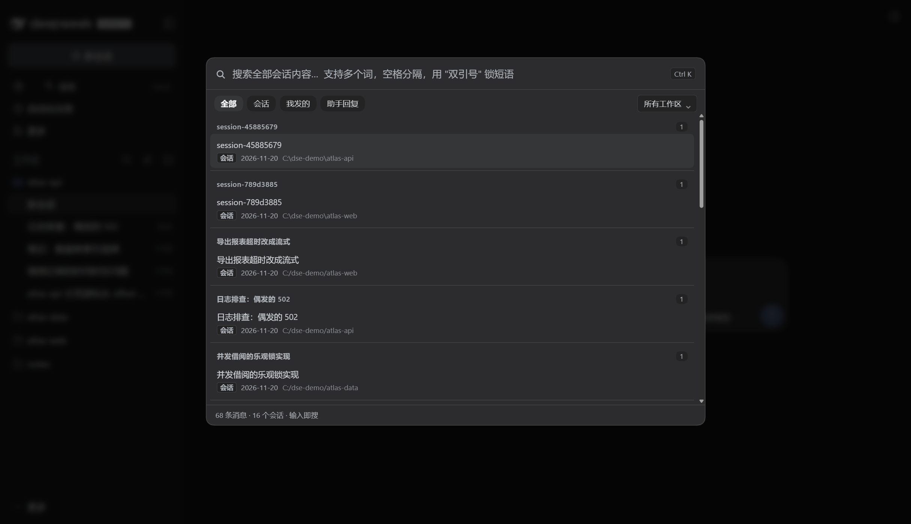

# dsh-search-everything

[English](README.md) · **中文**

给 [DSH](https://github.com/deepseek-ai/dsh) 用的 Everything 式全局搜索：按 **Ctrl K**，
在所有工作区的所有会话里搜索——会话标题、你发过的消息、助手的回复——回车直接跳到对话里
那条消息并高亮。

- 一个输入框，四个页签：全部 / 会话 / 我发的 / 助手回复
- 可选范围：用页签行右端的下拉框把搜索限定在单个工作区——31 MB 语料上 32 ms 降到 4 ms
- 索引跑在宿主进程内并落盘：重启后约 0.3 s 恢复，不用重新解压全部日志；约 30 MB / 1.8 万条
  消息上一次查询 10–90 ms
- 点结果会切工作区、切会话、滚到那条消息并闪一下高亮
- 纯本地：只读 `~/.dsh/sessions`，不上传、不联网、无埋点



范围下拉框把搜索限定在单个工作区：默认落在你当前所在的工作区（下图是 `atlas-api`，带「当前」标记），
展开后列出每个工作区及其消息数，收起时只占一个胶囊宽：


跳到命中处——目标消息被滚到视野中央并描边：


插件在侧栏加的入口：


## 安装

```bash
# 从本地目录安装
dsh plugin --profile web add link:/absolute/path/to/dsh-search-everything

# 或者从 npm 装（发布之后）
dsh plugin --profile web add dsh-search-everything
```

然后**重启 `dsh web`**——客户端 bundle 的 rev 只在宿主重载时才会变。重启之后：

- 侧栏「新会话」下面出现「搜索  Ctrl K」入口；
- 在任何地方按 **Ctrl K**（macOS 上是 **⌘ K**）打开面板，再按一次或 Esc 关闭。

## 用法

| 操作 | 按键 |
| --- | --- |
| 打开 / 关闭面板 | `Ctrl K` / `⌘ K` |
| 移动选中项 | `↑` `↓`（或 `Ctrl P` / `Ctrl N`） |
| 打开选中结果 | `Enter` |
| 切页签 | `Tab` / `Shift Tab`，或输入框为空时 `→` `←` |
| 开合工作区下拉框 | `Ctrl W`，或点范围控件 |
| 下拉框展开时选工作区 | `↑` `↓` 后 `Enter`，或直接点 |
| 关闭 | `Esc` |

查询语法：

- 空格分隔的词是 **AND**（`jellyfin port` = 同一条消息里两个词都有）
- 双引号搜短语（`"write failed"`）
- 大小写不敏感；中文按子串匹配（不分词）

> 这个插件**线性扫描**，不建倒排索引。真实数据（30 MB / 1.8 万条消息）上一个多词 AND
> 查询 10–90 ms，而倒排索引要花 20 多秒建库，还要双倍常驻内存。原因见下一节。

## 为什么不做倒排索引

第一版做过 3-gram 位图倒排（223 会话 / 1.6 万文档 / 71.3 万个 gram / 3000 万字符）。
实测：建库 23.5 s，单次查询 0–7 ms。结论：

- 线性扫描本来就够快：生僻词几乎能剪掉全部文档，最长的词先比，实际扫过的字符远少于语料规模；
- 倒排把「启动 4 秒可用」变成「启动 23 秒可用」，内存还要翻倍；
- 换来的只有每次查询省约 6 ms——人眼感知不到，而启动代价非常真实。

所以最朴素的路子留下来了：常驻内存的文档数组，加一个预转小写的 `lower` 字段，
用 `indexOf` 做多词 AND。

## 工作原理

```
~/.dsh/sessions/<编码后的 cwd>/<sessionId>/session.v4.jsonl.zstd
        │  zstd 解压 + 逐行 JSON（只取 user/message、assistant/message、session/title、会话头）
        ▼
宿主半区（src/engine.ts）—— 内存索引：{ sid, title, cwd, role, seq, time, text, lower }
        │  有 $DSH_HOME/storages/dsh-search-everything 就恢复，否则全量建；之后按需重扫，无后台轮询
        ▼
GET /dsh-search-everything-api/{refresh,query,sessions,workspaces,doc,stats,flush}   （只允许 loopback）
        ▼
浏览器半区（client.js）—— Ctrl K 面板、列表渲染、键盘处理、跳转与高亮
```

**只索引人说的话。** `user/message` 记录里有二十多种 `source.kind`；只有 `user`、
`user-approval`、`agent-message`、空字符串，以及 `dsh-ops:*`（排除 `step-tail`）算作真人输入。
`runtime-context`、`tool-jobs`、`repeat-tool-reminder`、`compact-checkpoint` 这类系统回声
一律丢弃——否则「我发的」页签里全是运行时上下文。

**跳转不是滚到底那么简单。** 面板先向宿主取命中的原文和偏移量，在偏移量附近切几段短摘录当
搜索 needle（长摘录匹配不上，因为 markdown 记号、行内代码、换行渲染后就没了），然后：

1. 需要时先 `unarchiveSession`——**已归档的会话在宿主里打开是静默失败的**；
2. 只有当宿主没挂任何会话时，才按 `sessionIds`/`path` 找到所属工作区并 `openWorkspace`；
3. `uiWorkspace.openSession(sid)` 切会话，等 `[data-conversation-session]` 报出目标会话；
4. 等消息流渲染出足够的 `[data-chat-flow-key]` 节点，再**逐屏向上滚**虚拟列表
   （它锚定在底部，直接 `scrollIntoView` 会被弹回），最后 `scrollIntoView({block:'center'})`
   并高亮 2.6 秒。

**范围是收窄扫描，不是事后过滤。** 文档按所属会话的工作目录分一次组并缓存，限定范围后只读
那一组——31 MB 语料上 `search` 从 32 ms 降到 4 ms，`Everything` 从 22 ms 降到 2 ms。
面板默认落在当前对话所在的工作区，页签行右端的控件可以切到别的工作区或回到全部。

**索引活过重启。** 建索引意味着解压并解析每一份会话日志——229 会话 / 31 MB 约 4.6 s，
冷页缓存下更糟。所以文档写进 `$DSH_HOME/storages/dsh-search-everything/`：`index.meta.json`
（每个会话文件的一条 stat 加标题/cwd）加 `docs.ndjson`（每条消息一个 JSON 元组），下次启动
**约 340 ms** 读回来，然后做一遍增量：只重读 mtime 或大小变了的文件。写入防抖 1.2 s 且原子
（临时文件 + rename），崩溃时旧索引仍然完整；版本或会话根不一致就丢弃缓存重建。

**刷新是按需的，不是定时器。** 之后索引一直不动，直到有人来要：面板一打开就调 `/refresh`，
给所有会话文件做一次 stat，只重读 mtime/大小变了的——没变化时几百毫秒，常见情况（一个会话
正在写）就是一个文件。两次打开之间插件零磁盘 IO，空闲的宿主保持空闲。

## 配置

在 `cordis.patch.yml` 的 `config` 块里：

```yaml
- insert:
    - id: dsh-search-everything
      name: dsh-search-everything
      config:
        refreshIntervalMs: 0      # 后台轮询间隔；0 = 关闭（默认，按需）
        lazyRefreshMs: 0          # >0 时，上次扫描超过这个时长就在 query 前先重扫一遍
        maxResults: 50            # 单次查询结果上限
        sessionsRoot: ''          # 会话根目录；默认 $DSH_HOME/sessions 或 ~/.dsh/sessions
        cacheDir: ''              # 磁盘索引目录；默认 $DSH_HOME/storages/dsh-search-everything
                                  # （写成 '-' 关闭持久化，每次启动重建）
```

## 开发

```bash
npm run build     # src/*.ts -> lib/*.js（用 Node 内置 stripTypeScriptTypes，无第三方依赖）
npm test          # node --test test/（13 个用例：索引/过滤/刷新/缓存/范围/坏文件）
npm run bench     # 真实语料上的建库与查询耗时
node scripts/bench-cache.mjs   # 真实语料上的冷建库 vs 热恢复
```

`client.js` 是手写的、**没有构建步骤**：它用 DSH 的 `window.__ModuleLoader__.load` 形式，
改完只要重启宿主（bundle rev 会变）。宿主半区必须 `npm run build`。

依赖政策：只用 Node 内置模块加 `@deepseek-ai/cordis` 的类型，没有第三方运行时依赖。

## 已知限制

- 只支持 Web（`dsh.client.platform = web`），桌面壳没适配。
- 第一次启动（还没有磁盘索引）仍然全量扫（30 MB 约 4–17 s；这段时间 `/query` 返回空并带
  `indexing: true`）。之后每次启动都从磁盘恢复。
- 索引文件约为被索引文本的 1.2 倍（31 MB 消息对应 37 MB），因为存的是原文；小写副本在加载时重算而不落盘。
- 单条消息只索引前 8000 个字符。
- 跳转靠文本摘录在 DOM 里匹配：目标消息几乎全是标记（纯表格、纯代码块）时精度会下降，
  插件会退化成「打开会话并尽量滚近」。

## 谁能调用这些 HTTP 路由

Host 半区只注册一条前缀路由 `/dsh-search-everything-api/*`，每个请求在读任何数据之前先过宿主自己的准入服务：

```ts
ctx.get('connection').requestRejection({ headers: req.headers }) // undefined = 放行，401 / 403 = 拒绝
```

这就是 DSH 给自己接口用的那把锁：`Host` 头既不是回环也不是受信主机（DNS rebinding）、
`Sec-Fetch-Site: cross-site`、`Origin` 与 Host 不同源、以及没有已认证 DSH 会话的浏览器请求，一律拒绝——
所以你浏览器里打开的别的网页没法通过这个插件读你的会话。判定按请求现取现判，不是激活时抓一次，
因为激活那一刻拿到的服务实例并不是之后真正在服务请求的那一个。宿主没有 `connection` 服务时，
退回只接受回环套接字。

## 参与改进

**欢迎提 issue 来更新这个插件。** Bug 和功能建议一样欢迎——这个插件就是靠这个变好的，也是最快拿到修复的路：

- 🐞 [报一个 bug](https://github.com/IvesCheung/dsh-search-everything/issues/new?template=bug_report.md)
- 💡 [提一个功能建议](https://github.com/IvesCheung/dsh-search-everything/issues/new)
- 💬 [随便问点什么](https://github.com/IvesCheung/dsh-search-everything/issues)

一个我能直接动手的 bug 报告包含：DSH 版本（`dsh --version`）、操作系统、你输入的完整查询、你期望什么、
实际发生了什么。如果是跳转问题，请说清是「面板没能切过去」还是「切过去了但没滚到命中位置」，并把浏览器
控制台里的红色报错贴上来。欢迎贴面板截图，但请把你自己会话里的隐私内容裁掉。

功能建议最好写**你的工作流需要什么**（「我想找到写这个文件的那次工具调用」），而不是怎么写。需要较大
改动才能做的方向：分词或前缀索引（让子词查询更便宜）、搜工具输出与附件名、以及 Web 之外的平台。

**也欢迎 PR**，小范围、自洽的改动最好。两条规则：只用 Node 内置模块（不要第三方运行时依赖），
提交前 `npm test` 全绿。`client.js` 没有构建步骤，宿主半区要 `npm run build`。不确定改动合不合
适就先开个 issue 聊两句，比 PR 被打回省事。

## 许可证

MIT
